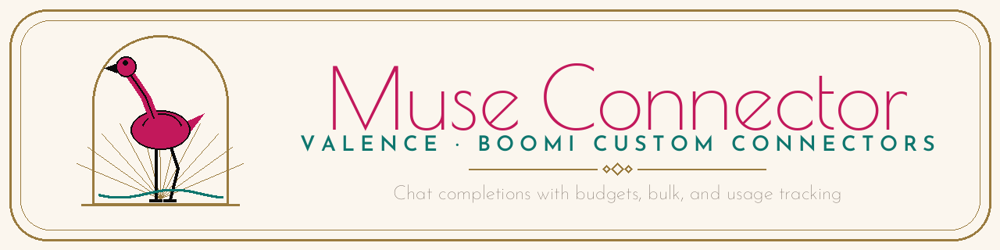
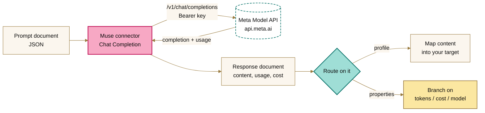
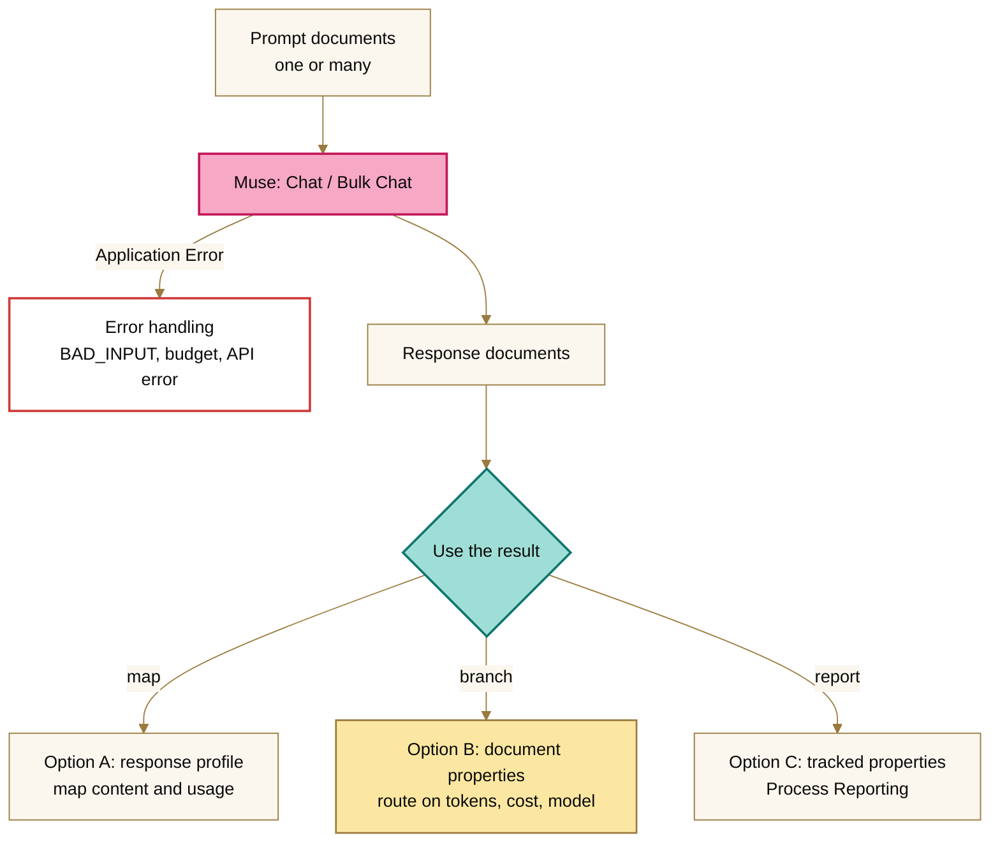

<picture>
  <source media="(prefers-color-scheme: dark)" srcset="../brand/assets/muse-banner-night.png">
  
</picture>

# Boomi Muse Connector

**Docs site:** [Muse Connector](https://brianbrinley.github.io/BoomiCustomConnectors/muse-connector/), with the latest connector download.

A native Boomi connector for the Muse API (Meta Model API). Send prompts from a Boomi process and get completions back as documents, with token usage and estimated cost attached to every response.

This exists because the generic HTTP connector makes you hand-roll everything: auth headers, retries, response parsing, per-document error handling, and usage accounting. This connector does that once, properly, and gives you a real connection screen instead of a pile of headers.



**Contents:**
[Quick start](#quick-start) ·
[Build](#build) ·
[Deploy in Boomi](#deploy-in-boomi) ·
[Connection fields](#connection-fields) ·
[Operations](#operations) ·
[Input and output](#input-and-output) ·
[Using results in a process](#using-results-in-a-process) ·
[Budgets](#budgets) ·
[Troubleshooting](#troubleshooting) ·
[Project layout](#project-layout)

## Quick start

1. **Get the files.** Download `muse-connector-1.0.0.zip` from the [`dist/`](dist/) folder. It holds the connector archive, ready to upload — no build needed. You can also build locally (see [Build](#build)).
2. **Upload it.** In Boomi: Manage → Connector Groups → your group → **Version upload**, then **Version change** to activate. No process redeploy needed.
3. **Get an API key.** Create one at [dev.meta.ai](https://dev.meta.ai), under API keys.
4. **Connect.** New Connection component → Muse → paste the key. **Test Connection** hits `GET /v1/models`; only a rejected key fails it.
5. **Run.** Connector step → **Chat Completion** → send `{"prompt": "Hello"}` → map `content` out of the response.

## Build

Requirements: JDK 17 (compiles to Java 8 bytecode). No Gradle, no Maven — one script:

```bash
./build.sh
```

This fetches dependencies on first run, compiles, lints the descriptor against the SDK schema, and writes `build/distributions/muse-connector.zip`.

Run the tests (fake HTTP transport; no sockets):

```bash
javac --release 8 -encoding UTF-8 -nowarn \
  -cp "build/classes:build/deps/*" \
  -d build/test-driver/classes \
  src/test/java/com/boomi/connector/muse/MuseConnectorTest.java
java -cp "build/test-driver/classes:build/classes:build/deps/*" \
  com.boomi.connector.muse.MuseConnectorTest
```

57 checks, all passing: retry loop, parsing, budgets, error-message extraction, dry run, debug logging, tracked properties, list-models, and all three operations.

### Build on GitHub (no local setup)

- **Download:** every push to `main` rebuilds the connector; open the run → **Artifacts** → `muse-connector` for the fresh zip and descriptor.
- **Release:** push a tag such as `muse-connector-v1.0.0`; the zip is attached to a GitHub Release.
- The `dist/` folder always holds the latest released zip, committed by the workflow.

## Deploy in Boomi

Upload the zip as a new connector version (connector group → version upload → version change to activate), then create a Connection component with your API key. Activating a new version needs no process redeploy.

## Connection fields

**Main page**

| Field | What it does |
|---|---|
| API key | Your key from dev.meta.ai, under API keys. Stored encrypted, never logged. |
| Base URL | The API base address. Default `https://api.meta.ai/v1`. |
| Model | Default model, e.g. `muse-spark-1.3`. A document can name a different one. |

**Performance page**

| Field | Default | What it does |
|---|---|---|
| Connect timeout (ms) | 10,000 | Give up connecting after this long. |
| Read timeout (ms) | 120,000 | Give up waiting for a response after this long. Reasoning models are slow; two minutes is a sane start. |
| Pooled connections, total | 64 | Size of the HTTP connection pool this connection keeps on the Atom. Connections are reused across executions instead of reopened. |
| Pooled connections, per host | 32 | How many pooled connections may talk to one host at once. |
| Bulk concurrency | 8 | How many documents the bulk operation sends at once. |
| Retries | 2 | Retries on rate limits (429) and server errors (5xx). A rejected key (401/403) is never retried — retrying can't fix it, so the execution fails fast. |
| Retry backoff (ms) | 1,000 | Wait before the first retry, doubling after each, with a little jitter. A `Retry-After` header wins when the API sends one. |
| Debug logging | off | Log a one-line summary of every API call (model, status, tokens) at INFO, plus full request and response bodies at FINE. Useful when a prompt misbehaves. |

**Budgets page**

Budgets are per execution, not per day. When one trips, the remaining documents are skipped with a clear `BUDGET_EXCEEDED` note instead of spending more. Nothing already completed is thrown away.

| Field | Default | What it does |
|---|---|---|
| Max input tokens | 0 (no limit) | Stop starting new requests after this many input tokens. |
| Max output tokens | 0 (no limit) | Same, for output tokens. |
| Max cost (USD) | blank (no limit) | Stop starting new requests past this estimated spend, e.g. `5.00`. |
| Price per 1M input tokens (USD) | 4.00 | Only used to estimate cost. Check dev.meta.ai for current pricing. |
| Price per 1M output tokens (USD) | 20.00 | Same, for output tokens. |

Under bulk concurrency a few requests can be in flight when a budget trips, so think of budgets as guardrails: no *new* request starts past the limit, but an execution can overshoot by a small margin.

## Operations

All three are EXECUTE type. Every knob resolves as **document > operation field > connection**: set a default temperature on the operation and override it in one document.

- **Chat Completion** — one input document in, one API call, one output document out. Documents run in order.
- **Bulk Chat Completion** — one API call per input document, sent with bounded parallelism (you set how many at once). Results come back in document order. A failed document is recorded against itself; the rest still run.
- **List Models** — asks the API which models your key can reach and returns them as one document (`{"models":[{"id":...}]}`). The input document is ignored; send one to trigger the call. Useful when you're deciding what to put in the connection's model field.

Operation fields (chat operations): **System prompt**, **Temperature** (0 focused, up to 2 adventurous), **Max tokens** (caps the response length), **Response format** (Text or JSON — JSON mode works best when the prompt itself mentions JSON), **Dry run** (build the request and return it as the document without calling the API; no key needed, no budget consumed — the response profile doesn't apply to dry-run output).

## Input and output

Send a JSON document. The simple form:

```json
{
  "prompt": "Summarize this release note in two sentences.",
  "system": "You are a terse technical writer.",
  "temperature": 0.3,
  "maxTokens": 200,
  "responseFormat": "json"
}
```

Or pass a full conversation through untouched:

```json
{
  "messages": [
    { "role": "system", "content": "You are a terse technical writer." },
    { "role": "user", "content": "Summarize this release note in two sentences." }
  ],
  "model": "muse-spark-1.3"
}
```

The output document, one per input:

```json
{
  "id": "chatcmpl-abc123",
  "model": "muse-spark-1.3",
  "content": "…the model's reply…",
  "finishReason": "stop",
  "usage": {
    "promptTokens": 42,
    "completionTokens": 118,
    "totalTokens": 160
  },
  "estimatedCostUsd": "0.002528"
}
```

The Import wizard offers the request and response shapes as JSON profiles, so you usually don't have to type them.

## Using results in a process

There are three ways to act on a result. Use whichever suits each shape.



### Option A: the response profile (recommended for maps)

On the operation, click **Import**. You get a JSON profile with `content`, `finishReason`, `usage/promptTokens` and friends. Use **Profile Element** parameters in shapes:

| Shape | Setting |
|---|---|
| **Map** | Map `content` into your target system's profile; map `usage/totalTokens` alongside it for cost tracking |
| **Decision** | `finishReason` Equal To `length` → the response was cut off; retry with a higher Max tokens |
| **Set Properties** | Stash `id` as a correlation id for the rest of the process |

### Option B: dynamic document properties (no profile needed)

Every output document carries these as document properties — read them with **Document Property → Dynamic Document Property** in Decision, Route, Map, or Notify shapes:

| Property | Example |
|---|---|
| `museResponseId` | `chatcmpl-abc123` |
| `museModel` | `muse-spark-1.3` |
| `museFinishReason` | `stop` (`length` means it hit the token cap) |
| `musePromptTokens` / `museCompletionTokens` / `museTotalTokens` | `42` / `118` / `160` |
| `museEstimatedCostUsd` | `0.002528` |

Handy when you want to branch without a map: a Decision shape can route on `museTotalTokens` Greater Than `4000`, or kill an expensive loop when `museEstimatedCostUsd` climbs.

### Option C: tracked properties (Process Reporting)

The same values are declared as **tracked properties**, so they're visible and searchable in **Process Reporting** without any extra shapes:

| Tracked property | Example |
|---|---|
| Muse Response ID | `chatcmpl-abc123` |
| Muse Model | `muse-spark-1.3` |
| Muse Finish Reason | `stop` |
| Muse Prompt / Completion / Total Tokens | `42` / `118` / `160` |
| Muse Estimated Cost (USD) | `0.002528` |

## Budgets

See [Connection fields](#connection-fields) — budgets are per execution. One more pattern worth knowing: put a cheap model on the connection for bulk classification work and override the model per document for the few that need the strong one. The `museEstimatedCostUsd` property makes the spend visible per document either way.

## Pooling, honestly

The pool lives in the Atom's JVM, one per connection, shared by every execution on that node. A cluster of three nodes has three pools — there is no such thing as a cross-node pool, and this connector doesn't pretend otherwise. What you do get: no per-request connection setup, idle connection eviction, and per-connection pool sizing.

## Troubleshooting

| Symptom | Likely cause |
|---|---|
| Execution fails: "Muse authentication failed (HTTP 401)" | The API key is wrong or revoked. Paste a fresh one from dev.meta.ai into the connection. |
| `Muse API error 400: model '…' not found` | The model name is wrong for your key. Run **List Models** to see what your key can reach. |
| `BUDGET_EXCEEDED` on documents | A budget tripped mid-execution. Raise it or narrow the input; completed documents are kept. |
| `BAD_INPUT` on a document | The document isn't a JSON object, or it has neither `prompt` nor `messages`. |
| `finishReason` is `length` | The response hit Max tokens. Raise it on the operation. |
| Prompt misbehaves and you can't see why | Turn on **Debug logging** on the Performance page and re-run; the process log shows the exact request and response. |

## Project layout

```
muse-connector/
├── README.md                  # this file
├── build.sh                   # the whole build: compile, lint, package
├── dist/
│   └── muse-connector-1.0.0.zip   # released archive, ready to upload
└── src/
    ├── main/java/com/boomi/connector/muse/   # the connector
    │   ├── MuseConnector.java       # entry point, operation routing, pool cache
    │   ├── MuseConnection.java      # connection fields, validation, defaults
    │   ├── MuseClient.java          # HTTP, retries, parsing, debug logging
    │   ├── MuseBaseOperation.java   # request building, budgets, tracked props
    │   ├── MuseExecuteOperation.java    # Chat Completion
    │   ├── MuseBulkChatOperation.java   # Bulk Chat Completion
    │   ├── MuseListModelsOperation.java # List Models
    │   └── MuseBrowser.java         # profiles, Test Connection
    ├── main/resources/META-INF/
    │   └── connector-descriptor.xml # the Boomi UI: fields, pages, operations
    └── test/java/…/MuseConnectorTest.java  # 57 checks, fake HTTP transport
```

## Notes

- SDK 2.31.0, strict class loading. `connector-sdk-api` is provided by the runtime and intentionally left out of the archive.
- A wrong API key fails the whole execution loudly (`ConnectorException`). A bad document, a rate limit that survives retries, or a tripped budget fails just that document and the rest keep going.
- Built with the [boomi-connectordev](https://github.com/OfficialBoomi/boomi-connectordev) skill. Where this project deviates from its supported path (javac instead of Gradle), the reason is written down at the deviation, not just here.
